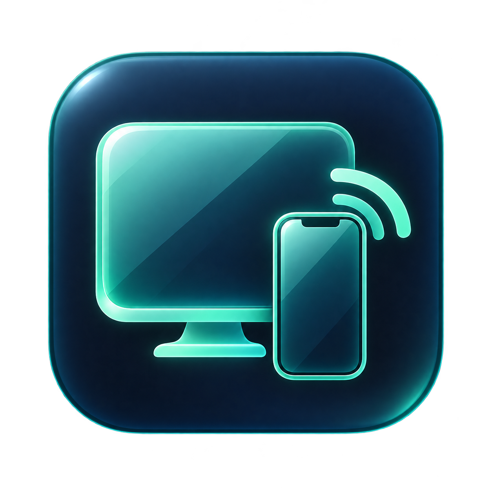

# AirGlass

An AirPlay screen-mirroring receiver for Windows. Show your iPhone screen on your PC, with adjustable resolution, frame rate and latency settings.



## Installer (recommended)

Download **AirGlass-Setup-2.7.2.exe** from this repository's Releases page and run it. Setup installs the complete app for your Windows account, adds a Start menu shortcut, offers a desktop shortcut, and includes an uninstaller in Windows Settings → Apps. Setup checks for .NET Framework 4.8 before installing. If Apple Bonjour is missing, [download Bonjour Print Services for Windows from Apple](https://support.apple.com/106380), or use the official download link on the finish page; install Bonjour before using AirGlass. Neither prerequisite is silently bundled or installed. Your saved preferences and pairing keys are retained when you uninstall.

### Windows security warning (unsigned installer)

> **AirGlass is currently unsigned.** Windows may show **“Windows protected your PC”** or **“Unknown publisher”** when you open the installer. This means Windows cannot verify the publisher; it is not a guarantee that the file is safe or unsafe.

If you trust AirGlass and want to continue:

1. Download the installer only from [this repository’s official Releases page](https://github.com/alisyed-03/AirGlass/releases).
2. Check its SHA-256 against the matching `.sha256.txt` file attached to the same release. In PowerShell, run `Get-FileHash .\AirGlass-Setup-2.7.2.exe -Algorithm SHA256` and compare the hash.
3. In the **“Windows protected your PC”** dialog, choose **More info**, then **Run anyway**, if that option is available.

If **Run anyway** is unavailable, your device’s security settings or organization policy may block unsigned apps. Contact your administrator on a managed device. Do not disable Microsoft Defender, SmartScreen or Smart App Control to install AirGlass. If antivirus reports a specific malware detection, stop and investigate rather than treating it as the unsigned-publisher notice.

The portable ZIP remains available, but its unsigned app may show the same warning.


Version 2.7.2 includes the updated installer and portable package for Windows 11 ARM64 x64 emulation; see [Windows ARM compatibility](WINDOWS-ARM.md).

## Portable download and run

1. Open this repository's **Releases** page and download **AirGlass-Windows-portable.zip**. GitHub's automatic “Source code” downloads are for building the project and do not include the runnable engine/runtime.
2. Extract the **entire ZIP** to a folder you can write to. Keep `AirGlass.exe`, `engine`, `assets` and the license files together. Do not run the EXE from inside the ZIP or copy only the EXE.
3. Install **.NET Framework 4.8** and **[Apple Bonjour](https://support.apple.com/106380)** if they are missing; see Requirements below.
4. Open **AirGlass.exe**. The receiver starts automatically.
5. Put your iPhone and PC on the same local network. On iPhone, open **Control Center → Screen Mirroring → AirGlass**.
6. If Windows Firewall asks, allow the receiver on your trusted private/home network.

Video appears in a separate window. **Alt + Enter** toggles full screen. Closing AirGlass stops the receiver. After changing settings, select **Save & restart receiver** and reconnect from your iPhone.

## Features

- Default **1080p, up to 30 fps**.
- Resolution requests: 480p, 720p, 900p, 1080p, 1440p and 4K.
- Frame-rate limits: **15, 30 and 60 fps**.
- **Best latency** keeps short queues and displays the newest waiting decoded frame. **Smooth frame pacing** adapts a small waiting cushion to recent jitter.
- **Best picture** prioritizes preserving frames and audio/video timing.
- Automatic hardware detection, manual decoder selection, audio, full screen and receiver-name settings.

The requested resolution and FPS are not guaranteed output. The iPhone, content, aspect ratio, codec and network determine the delivered stream. Portrait video keeps its aspect ratio. Higher resolutions need a compatible HEVC sender. Some protected video cannot be mirrored.

## Settings

The main panel contains Receiver name, Resolution, Maximum frame rate and Performance preference. **Play iPhone audio** is an on/off switch directly below the performance preference. Select **Settings** underneath it to show or hide Video decoder, Smooth frame pacing and Open video in full screen. Settings stay saved when the additional controls are hidden.

Use **Save & restart receiver** after making changes, then reconnect from the iPhone. Normal Stop/restart withdraws the Bonjour services, waits for the local removal event, keeps the same available port block and allows a one-second quiet interval before replacement; forced termination is reserved for an unresponsive process. “Ready” waits for the registration callback, a local Bonjour browse result and the TCP listener. Saving unchanged settings keeps the active receiver running. Unconfirmed discovery receives one bounded automatic retry.

## Adaptive quality (source build)

Select **Best latency**, enable **Adaptive quality**, then **Save & restart receiver**. Your selected resolution and FPS remain the saved maximum. While video is arriving, sustained receiver delay above 150 ms or jitter above 40 ms for eight seconds triggers a lower request: 60 → 30 fps, then one resolution step at a time down to 720p, then 15 fps. A lower maximum such as 480p is retained. Startup has a 20-second grace period; further adjustments have at least a 60-second cooldown. Missing telemetry and static screens do not trigger adaptation. Best picture does not expose the required native timing data, so adaptive mode is disabled for that preference.

**Each adjustment restarts the receiver and may disconnect mirroring. Reconnect from Control Center → Screen Mirroring when prompted.** Quality stays reduced for that receiver session; manually Stop/Start to retry your saved maximum. It does not automatically raise quality and interrupt a stable stream. Disable the option to keep manual quality control.

This uses local receiver delay and jitter as feedback, not an internet speed test. PC decoding load can also trigger it, and it cannot detect every Wi-Fi problem. Resolution/FPS are requests to the iPhone, not guaranteed output. The feature is available in source builds and is not included in the published v2.7.2 downloads yet.

## Automatic GPU decoding

New profiles default to **Video decoder → Direct3D11 hardware**, with CPU fallback if the required codec is unavailable. NVIDIA NVDEC is now opt-in: its plugin is stored outside the normal scan folder and is loaded only for NVIDIA or Automatic mode. **Automatic · detect hardware** remains available for the broader fallback order below. AirGlass checks H.264 and HEVC independently on each receiver start, using the installed driver and codec factories rather than a graphics-card name alone.

| Priority | Decoder | When it is used |
| --- | --- | --- |
| 1 | Direct3D11 hardware | Compatible NVIDIA, Intel or AMD Windows video decoder |
| 2 | NVIDIA NVDEC | Compatible NVIDIA codec/driver/runtime when Direct3D11 is unavailable |
| 3 | Software | CPU decoding when hardware support is unavailable |

**Direct3D11 on an NVIDIA card uses NVIDIA's hardware video decoder.** Direct NVDEC is an alternative API path, not a requirement for NVIDIA acceleration. This GStreamer version's direct NVDEC path needs an extra CUDA format conversion; local tests and phone feedback favored the native Direct3D11 path. Automatic therefore prefers Direct3D11. This is a tested default, not a promise that one mode is fastest on every PC.

Only compatible decoders are promoted. GStreamer retains alternatives for unsupported stream profiles and initialization failures. The log records available codecs and the actual decoder used when video arrives. Manual NVIDIA NVDEC, Direct3D11 and Software choices remain available for comparison. Hardware decoding can reduce CPU usage; network delay and frame pacing still affect responsiveness.

NVIDIA support does **not** require the full CUDA Toolkit. Required application runtime DLLs are bundled privately; an appropriate installed NVIDIA driver is needed only for NVIDIA acceleration. PCs without NVIDIA can use Direct3D11 or software.

## Requirements

- **Windows 10/11 x64, or Windows 11 ARM64 using x64 emulation**, with a working Direct3D11 display/driver. Windows 10 on ARM is unsupported. The app and bundled runtime remain x64; see [Windows ARM compatibility](WINDOWS-ARM.md) for prerequisites and validation status.
- **[.NET Framework 4.8](https://dotnet.microsoft.com/download/dotnet-framework/net48)** or later compatible .NET Framework. The modern .NET runtime alone does not replace .NET Framework.
- **Apple Bonjour Service**, installed and running. [Download Bonjour Print Services for Windows from Apple](https://support.apple.com/106380). Run `BonjourPSSetup.exe`, follow the installer prompts, then reopen AirGlass. The app displays setup guidance if Bonjour is absent; it does not silently install system software.
- An iPhone capable of AirPlay Screen Mirroring, on a local network that permits device discovery.

You do not need Python, MSYS2, GStreamer, a compiler, the CUDA Toolkit or the developer's folders to run the complete release. No receiver keys, saved PC-specific settings, IP addresses or plugin caches are shipped. Extract portable updates into a fresh folder; installer updates remove the older always-scanned NVIDIA plugin. Each user gets their own settings and keys under `%LOCALAPPDATA%\AirGlass`; the install folder does not store runtime preferences.

The unsigned EXE may show a Windows reputation prompt. Verify the release SHA-256 and download from a trusted release. Routine use does not require running AirGlass as administrator. Installing prerequisites or approving firewall access may require Windows permissions.

## Troubleshooting

| Problem | What to check |
| --- | --- |
| Receiver missing on iPhone | Bonjour Service is running; same local network; firewall allows `engine\bin\uxplay.exe`; no guest Wi-Fi/client isolation or conflicting VPN route. Close and reopen Screen Mirroring. |
| App asks for setup | Use **Connection help**. You can also run the included `Check-Setup.ps1` for read-only prerequisite checks. |
| Missing engine or DLL | Extract the complete release ZIP again. Keep the folder structure intact. Do not download only the EXE or GitHub's source archive. |
| Delay or jitter | Start with Best latency + Smooth frame pacing + Direct3D11. Compare Software. Try 720p/30 and connect the PC to the router by Ethernet if possible. |
| NVIDIA mode unavailable | Automatic uses the next compatible decoder. For direct NVIDIA support, check the installed driver and keep bundled runtime DLLs intact. |
| Settings need resetting | Close AirGlass and rename `%LOCALAPPDATA%\AirGlass\settings.xml`, then reopen. This resets preferences only. |

AirGlass uses Bonjour/mDNS discovery and available receiver ports in the 7100–7201 range. Open **Connection help** for the selected ports and receiver log. Best latency may trade audio synchronization for responsiveness. The live timing footer measures receiver processing up to presentation submission; it excludes phone capture/encoding, Wi-Fi transit, GPU completion and display scanout.

## Build from source

Interface source and build scripts are in `source`; complete modified native receiver source is `source/AirGlassEngine-source.zip`. The native engine is based on UxPlay v1.72, pinned to commit `7fc5f4d9b969dbb703ca59eb47697ff51b8cb7a5`.

For a full runnable developer checkout, extract a matching release into your build folder so `engine` is present, then overlay the repository source files. Rebuild the UI with the .NET Framework 4.8 compiler:

```powershell
powershell -NoProfile -ExecutionPolicy Bypass -File .\source\build.ps1
```

To build the installer from a full matching release folder, install Inno Setup 6.7 or later, then run `source/build-installer.ps1 -Compiler "C:\Program Files (x86)\Inno Setup 6\ISCC.exe"`. The installer source is `source/installer.iss`.

To rebuild the native receiver, install MSYS2 MINGW64 with GCC, CMake, Ninja, pkgconf, GStreamer/base development libraries, OpenSSL and libplist, then run:

```powershell
powershell -NoProfile -ExecutionPolicy Bypass -File .\source\build-native.ps1 -MsysRoot C:\msys64
```

The native source builds for generic x64 with `NO_MARCH_NATIVE=ON`. The release used GStreamer SDK 1.28.8 and the bundled 1.26.2 runtime. Replacing SDK/runtime versions requires retesting. Native integration tests are available with CMake `-DAIRGLASS_BUILD_TESTS=ON`. UI self-tests: `AirGlass.exe --self-test C:\Temp\AirGlass-QA`; protocol tests require Python and are in `source/protocol_test.py`. Close the normal app before tests using its ports.

## Update in 2.7.2

- Added installer compatibility for **Windows 11 ARM64 through x64 emulation**. Windows 10/11 x64 remains supported; Windows 10 ARM is unsupported.
- Updated setup diagnostics to detect the host architecture and check the 64-bit .NET Framework registry view.
- Published the rebuilt **AirGlass-Setup-2.7.2.exe**, complete portable ZIP and SHA-256 checksums on the [v2.7.2 release page](https://github.com/alisyed-03/AirGlass/releases/tag/v2.7.2).
- Added [Windows ARM setup guidance](WINDOWS-ARM.md), including x64 Bonjour requirements and decoder troubleshooting.
- Automated platform checks and x64 installer install/uninstall tests passed. The app and media runtime remain x64; physical ARM64 discovery and iPhone streaming tests are still pending.

## Update in 2.7.1

A notice beneath the connection steps says: “If AirGlass doesn’t appear in Screen Mirroring, click Stop receiver, then Start receiver, and try again.” The 2.7 video and discovery behavior is retained.

## Changes in 2.7

Best latency now uses lower-delay H.264 picture output for Direct3D11. The user's iPhone test reported **“More responsive and smooth.”** The median receiver decode-stage delay dropped from about 192 ms to 0.34 ms; median receiver input-to-presentation submission dropped from about 198 ms to 23 ms across separate sessions. These are receiver-stage readings, not phone-to-screen latency. Best picture retains the standard policy for video requiring conservative picture reordering. The window-close producer/renderer race is also fixed. See `CHANGES-2.7.md` for the measurements and limits.

## Earlier changes in 2.6

Direct3D11 is the default. Its normal launch does not load CUDA/NVDEC. GPU decoder textures go directly to the video sink, avoiding the forced upload/convert chain. Best latency disables retained last-frame samples and upstream QoS feedback while keeping the bounded decoded-frame queue. The receiver now requests 1-ms Windows timer resolution while its low-latency renderer exists, then releases it on teardown. Adaptive smoothing sheds temporary waiting four times faster, gradually at 4 ms per second.

The same receiver object is tested through eight name-preserving settings restarts, including the real app's Bonjour removal observer, quiet interval and stable port choice. Clock tests cover temporary-jitter recovery; actual 1080p H.264/HEVC GPU tests cover the simplified sink path. These do not establish phone-to-monitor latency or guarantee that every Wi-Fi/iPhone discovery issue is resolved. See `CHANGES-2.6.md`.

## Validation and limitations

Version **2.7.1** was tested on Windows with an RTX 3060 Ti. Version **2.7.2** updates packaging and Windows ARM compatibility; automated platform and x64 install/uninstall checks cover the new packaging, while physical ARM64 streaming tests remain pending. Tests cover actual 1080p/60 H.264 and HEVC decoding/rendering, simulated missing codec capabilities, CPU fallback, settings persistence, receiver startup, protocol advertisement and Bonjour discovery. Earlier portability checks also tested a relocated folder containing spaces and a non-ASCII character, with development tools removed from PATH. Bundled PE imports were checked for missing runtime dependencies. See `TEST-RESULTS.txt`.

Fallback capability tests are simulations on the same PC; they do not replace physical Intel/AMD/older NVIDIA or clean Windows installations. End-to-end iPhone latency and universal hardware compatibility are not guaranteed. Network isolation, unsupported drivers and missing prerequisites can still prevent operation.

## License and credits

AirGlass project code and artwork are provided under **GPL-3.0-or-later**; see `LICENSE.txt`. The modified UxPlay source is included. Third-party components keep their own licenses. In particular, NVIDIA NVRTC DLLs in the runnable release are proprietary NVIDIA redistributable components with separate terms; they are not relicensed under GPL. See `THIRD-PARTY.md` and `licenses` for provenance and notices.

AirPlay and Bonjour are Apple trademarks. AirGlass is an independent project and is not affiliated with Apple or NVIDIA.
